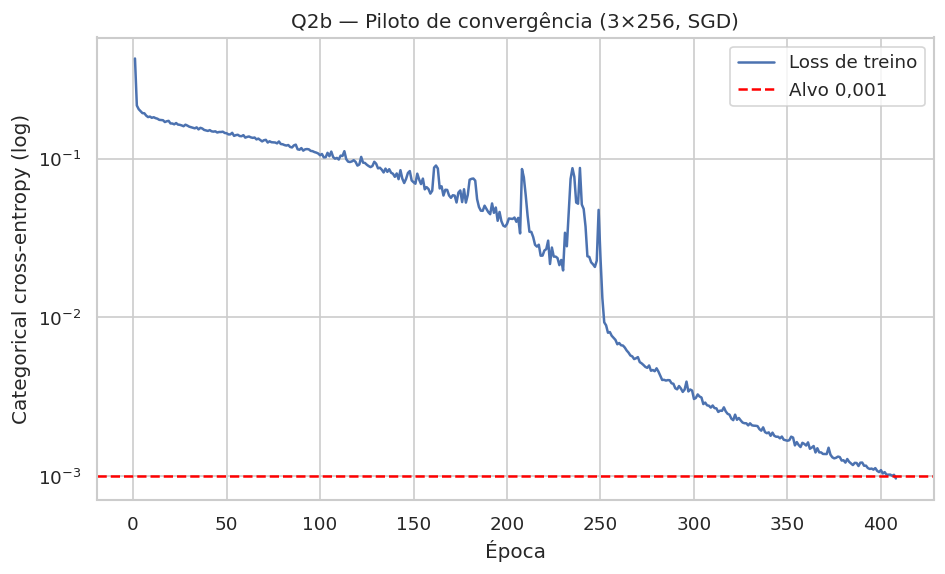

# Q2b — Piloto de convergência com 500 épocas

**Branch:** `feat/q2b-convergencia-500ep`  
**Base:** tag `v1.0.0` (V1 preservada)  
**Data:** 06/11/2026  
**Autores:** Pedro Otávio e Gabriel Marques

> Experimento suplementar. Não altera a V1.0.0 nem substitui Q1–Q7.

## 1. Objetivo

Testar se uma MLP maior, com até 500 épocas e scheduler, atinge a loss de treino ≤ 0,001 exigida pelo critério de convergência. O teste foi usado apenas na avaliação final.

## 2. Configuração

| Item | Valor |
|---|---|
| Topologia | 3 camadas × 256 neurônios |
| Ativações | ReLU / Softmax |
| Perda | Entropia cruzada categórica |
| Otimizador | SGD, momentum 0,9 |
| Learning rate | 0,01 com `ReduceLROnPlateau` (fator 0,5, paciência 20, mínimo 1e-5) |
| Batch | 32 |
| Dados de treino | 70% de desenvolvimento (9.528 exemplos) |
| Teste | 30% (4.083 exemplos), apenas na avaliação final |
| Máximo de épocas | 500 |
| Alvo | Loss de treino ≤ 0,001 |
| Parada de segurança | Sem melhora > 1e-4 por 100 épocas ou 45 min |
| Seed | 42 |
| Parâmetros | 137.735 |

## 3. Resultados

| Métrica | Valor |
|---|---|
| Status | Convergiu |
| Motivo da parada | `target` |
| Épocas executadas | 408 |
| Melhor loss de treino | 0,000967 (época 408) |
| Loss de treino (avaliação) | 0,000943 |
| Acurácia de treino | 1,0000 |
| Macro-F1 de treino | 1,0000 |
| Loss de teste | 0,7864 |
| Acurácia de teste | 0,9185 |
| Macro-F1 de teste | 0,9323 |
| Weighted-F1 de teste | 0,9185 |
| Precisão macro de teste | 0,9325 |
| Revocação macro de teste | 0,9322 |
| Tempo de treino | 277,8 s |

*Figura 1 — Loss de treino do piloto Q2b (escala logarítmica) e alvo de 0,001.*

## 4. Análise

O piloto **atingiu o critério**: a loss de treino chegou a 0,000967 na época 408, dentro do limite de 500 épocas. Isso mostra que o alvo de 0,001 é viável com uma rede maior e scheduler, mesmo mantendo SGD com momento.

O custo foi um overfitting acentuado: a acurácia e o macro-F1 de treino chegaram a 1,0000, enquanto no teste a acurácia foi 0,9185 e o macro-F1 0,9323. A loss de teste subiu para 0,7864. O desempenho de teste ficou abaixo do modelo da V1 (macro-F1 0,9402), o que indica que a busca pelo critério de treino sacrificou generalização.

## 5. Conclusão

- O critério de 0,001 é **alcançável** com 3×256, SGD + `ReduceLROnPlateau`, 70% de desenvolvimento e 408 épocas.
- O modelo que converge para 0,001 **não é superior** ao modelo da V1 em teste; portanto, a V1 permanece como entrega oficial.
- Este experimento serve como evidência de viabilidade e como base para uma eventual discussão com o professor sobre o trade-off entre convergência de treino e generalização.
- A branch não deve ser integrada à `main` sem autorização explícita.
