# Classificação de Grãos de Feijão Seco com MLP Treinada por Backpropagation

**Autores:** Pedro Otávio e Gabriel Marques  
**Versão:** 1.1.0 — V1.0.0 + Apêndice B (Q2b)  
**Projeto:** `mlp-dry-bean-backprop`  
**Data:** 06/11/2026  
**Ambiente:** Python 3.11.15; TensorFlow 2.15.1 (CPU); NumPy 1.26.4; Pandas 2.1.4; Scikit-learn 1.3.2; 16 vCPUs; 6,6 GB de RAM; sem GPU.  
**Código:** `notebooks/01_experimentos.ipynb` e `notebooks/02_analise_resultados.ipynb`.  
**Resultados:** `results/csv/`, `results/figures/` e `results/tables/`.

> Todos os valores deste relatório foram obtidos dos CSVs gerados pela execução dos notebooks. Nenhum resultado foi inventado.

## 1. Introdução e contextualização

A classificação automática de variedades de grãos é um problema multiclasse com classes parcialmente sobrepostas no espaço de atributos. Este trabalho utiliza o Dry Bean Dataset, composto por 13.611 instâncias descritas por 16 atributos numéricos contínuos extraídos de imagens, distribuídas em 7 classes: Seker, Barbunya, Bombay, Cali, Dermason, Horoz e Sira.

O dataset foi obtido do UCI (ID 602) e convertido do ARFF original para CSV, preservando as 16 features e o rótulo `Class`. O modelo adotado é uma Multilayer Perceptron (MLP) treinada por Backpropagation, com ReLU nas camadas ocultas e Softmax na saída. O estudo segue sete etapas: inicialização de pesos (Q1), learning rate e momento (Q2), topologia (Q3), quantidade de dados (Q4), atributos (Q5), avaliação final no teste (Q6) e validação cruzada (Q7).

## 2. Dataset e metodologia

A distribuição das classes é desbalanceada, como mostra a Tabela 1. Dermason concentra 3.546 exemplos, enquanto Bombay possui 522. Por isso, a métrica principal é o macro-F1, que pondera igualmente as classes; a acurácia e o weighted-F1 são reportados como complementares.

| class | count |
|---|---|
| Dermason | 3546 |
| Sira | 2636 |
| Seker | 2027 |
| Horoz | 1928 |
| Cali | 1630 |
| Barbunya | 1322 |
| Bombay | 522 |

**Split.** Foi adotado split externo estratificado de 70% desenvolvimento e 30% teste (seed 42). O desenvolvimento foi dividido em 80% treino e 20% validação, resultando em 56% treino, 14% validação e 30% teste. A Q1 usa apenas o treino de 56%; Q2–Q5 usam treino/validação; a Q6 treina nos 70% de desenvolvimento e avalia no teste de 30%; a Q7 faz validação cruzada k=5 no desenvolvimento de 70%, mantendo o teste intocado.

**Pré-processamento.** As classes foram codificadas em one-hot. O `StandardScaler` (Z-score) foi ajustado exclusivamente no treinamento correspondente e aplicado à validação/teste; a escolha do Z-score se deve à presença de atributos com escalas muito distintas e valores extremos, situação em que o Min-Max é mais sensível. Nas frações da Q4, o scaler foi reajustado no subconjunto de treino. Na Q5, a seleção de atributos usou somente o treino. Na Q7, scaler e regra de atributos foram reajustados dentro de cada fold.

**Modelo.** MLP com ativação ReLU nas camadas ocultas, inicialização Glorot uniform, saída Softmax com 7 neurônios, perda de entropia cruzada categórica, SGD com momento e batch size 32. Não foram usados dropout, regularização, class weights ou early stopping na validação. O critério de convergência foi loss de treino ≤ 0,001. A Q1 usou 100 épocas fixas; Q2–Q7 usaram no máximo 150 épocas. No protocolo principal, nenhuma configuração atingiu o limiar de 0,001; um experimento suplementar posterior (Apêndice B) atingiu o critério com 3×256 em 408 épocas, mas com pior generalização.

**Métricas.** Loss, acurácia, macro-F1, weighted-F1, precisão/revocação macro, tempo de treinamento, épocas e número de parâmetros. As regras de seleção foram definidas antes dos experimentos e aplicadas sem ajuste após os resultados.

## 3. Configurações experimentais

| Item | Decisão |
|---|---|
| Split externo | 70% desenvolvimento / 30% teste, estratificado, seed 42 |
| Split interno | 80% treino / 20% validação do desenvolvimento (56/14/30 efetivo) |
| Q1 | 16-60-7; ReLU/Softmax; SGD lr=0,01, momento=0,9; 100 épocas; seeds 42–46 |
| Q2 | lr {0,01; 0,1; 0,5} × momento {0,5; 0,7; 0,9}; 9 combinações; máximo 150 épocas |
| Q3 | 1–3 camadas; 10–100 neurônios, passo 10; largura uniforme; 30 configurações |
| Q4 | 20%, 40%, 60%, 80%, 100% do treino de 56%; amostragem estratificada |
| Q5 | `all_16`, `low_redundancy` (|r| ≥ 0,95), `top_10_mi`, `compact`, `no_noise` |
| Q6 | Top 4 da Q3 + Q2 + regra de atributos da Q5; treino 70%, teste 30% |
| Q7 | k=5 estratificado no desenvolvimento de 70%; scaler/seletor dentro de cada fold |
| Batch size | 32 |
| Perda | Entropia cruzada categórica |
| Otimizador | SGD com momento (`nesterov=False`) |
| Critério de parada | Loss de treino ≤ 0,001; máximo de 150 épocas |
| Seeds | Q1 42–46; Q2–Q6 42; Q7 folds com seed 42 |

O tempo total de treinamento registrado foi de aproximadamente 116 minutos, dos quais cerca de 80 minutos correspondem à Q3. Os tempos por execução estão nos CSVs.

## 4. Resultados e discussão — Q1

**Configuração.** Topologia 16-60-7, ReLU/Softmax, SGD lr=0,01 e momento=0,9, 100 épocas, cinco seeds e somente o conjunto de treino (7.621 exemplos).

| seed | loss_final | accuracy_final | macro_f1_final | time_s |
|---|---|---|---|---|
| 42.0000 | 0.1620 | 0.9436 | 0.9527 | 31.6624 |
| 43.0000 | 0.1616 | 0.9437 | 0.9532 | 33.0142 |
| 44.0000 | 0.1592 | 0.9424 | 0.9523 | 53.7355 |
| 45.0000 | 0.1612 | 0.9429 | 0.9523 | 48.7645 |
| 46.0000 | 0.1597 | 0.9431 | 0.9518 | 51.2766 |

**Análise.** As cinco inicializações produziram resultados muito próximos: loss final média 0.1607 ± 0.0012, acurácia final 0.9431 ± 0.0005 e macro-F1 final 0.9525 ± 0.0005. A dispersão é baixa, indicando que a arquitetura é pouco sensível à inicialização dentro das seeds testadas. As curvas de loss e acurácia (Figuras 1 e 2) mostram convergência suave, sem divergência ou estagnação evidente.

Como apenas o treino foi utilizado, não é possível confirmar overfitting; a loss continuou caindo lentamente e a acurácia se aproximou de 94,3%. A topologia e as ativações escolhidas se mostraram adequadas para servir de base à Q2.

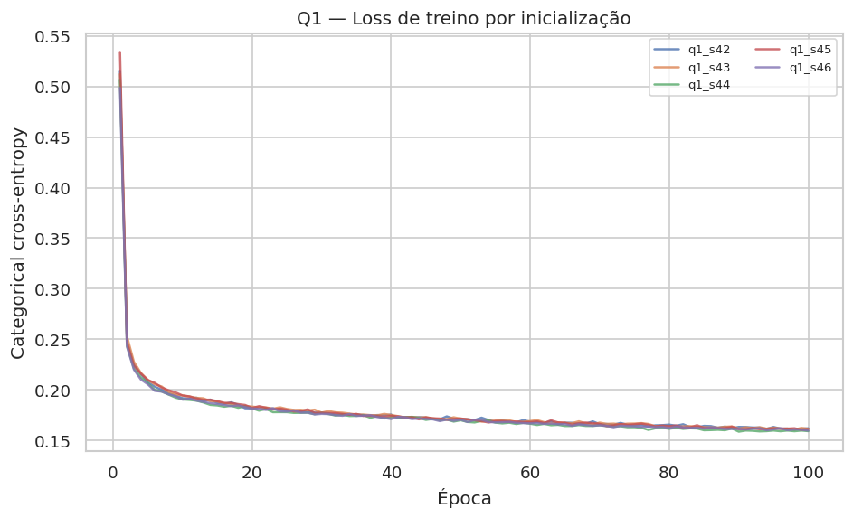

*Figura 1 — Loss de treino por inicialização (Q1).*

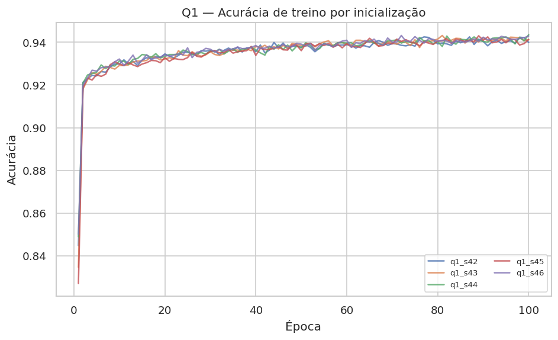

*Figura 2 — Acurácia de treino por inicialização (Q1).*

**Conclusão da Q1.** O modelo aprende padrões básicos de forma estável; a inicialização não foi um fator crítico. A topologia 16-60-7 foi mantida na Q2.

## 5. Resultados e discussão — Q2

**Configuração.** Nove combinações de learning rate e momento, mantendo a topologia da Q1, treino/validação e máximo de 150 épocas.

| run_id | learning_rate | momentum | loss_train | acc_train | loss_val | acc_val | macro_f1_val | time_s | selected |
|---|---|---|---|---|---|---|---|---|---|
| q2_lr0.01_m0.9 | 0.0100 | 0.9000 | 0.1524 | 0.9448 | 0.1934 | 0.9334 | 0.9477 | 90.4728 | True |
| q2_lr0.01_m0.5 | 0.0100 | 0.5000 | 0.1705 | 0.9386 | 0.1997 | 0.9318 | 0.9445 | 124.4249 | False |
| q2_lr0.01_m0.7 | 0.0100 | 0.7000 | 0.1648 | 0.9398 | 0.1978 | 0.9313 | 0.9442 | 104.5845 | False |
| q2_lr0.1_m0.5 | 0.1000 | 0.5000 | 0.1459 | 0.9462 | 0.1943 | 0.9286 | 0.9419 | 105.5240 | False |
| q2_lr0.1_m0.7 | 0.1000 | 0.7000 | 0.1456 | 0.9461 | 0.2081 | 0.9255 | 0.9400 | 112.2521 | False |
| q2_lr0.5_m0.5 | 0.5000 | 0.5000 | 0.1738 | 0.9402 | 0.2649 | 0.9271 | 0.9394 | 113.9530 | False |
| q2_lr0.1_m0.9 | 0.1000 | 0.9000 | 0.1656 | 0.9392 | 0.2588 | 0.9239 | 0.9388 | 103.0194 | False |
| q2_lr0.5_m0.7 | 0.5000 | 0.7000 | 0.2089 | 0.9339 | 0.3099 | 0.9176 | 0.9313 | 108.8195 | False |
| q2_lr0.5_m0.9 | 0.5000 | 0.9000 | 1.6892 | 0.2988 | 1.7168 | 0.2980 | 0.2027 | 91.7031 | False |

**Análise.** A melhor combinação foi **lr=0,01 e momento=0,9**, com macro-F1 de validação 0.9477, loss de validação 0.1934 e acurácia de validação 0.9334. Taxas de 0,01 e 0,1 apresentaram comportamento estável; lr=0,5 com momento=0,9 degradou fortemente o aprendizado (loss de treino 1.6892, macro-F1 0.2027), evidenciando instabilidade com taxa alta e momento alto.

Nenhuma das nove configurações atingiu a loss de treino de 0,001 em 150 épocas; todas foram registradas como `converged=False`. A seleção seguiu a regra de fallback: melhor macro-F1 de validação entre as execuções válidas. O heatmap de macro-F1 (Figura 3) e as curvas de loss (Figura 4) mostram que o ganho de desempenho se concentra em taxas menores, com 0,01 e 0,1 próximas.

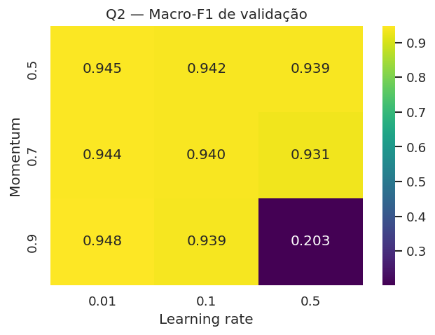

*Figura 3 — Macro-F1 de validação por learning rate e momento (Q2).*

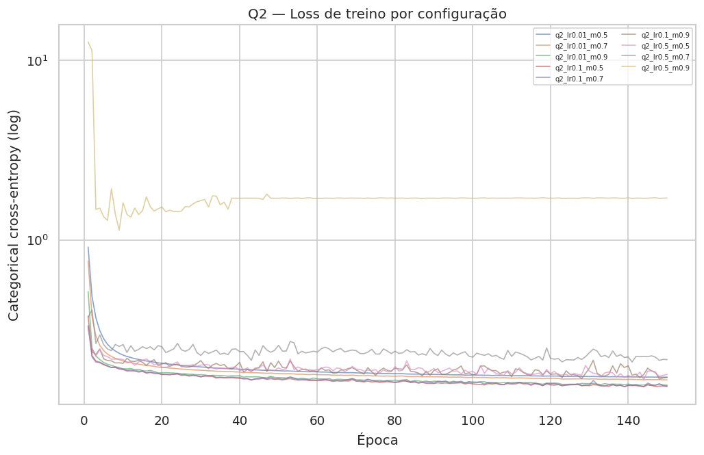

*Figura 4 — Curvas de loss por configuração (Q2).*

**Conclusão da Q2.** A combinação lr=0,01 e momento=0,9 ofereceu o melhor equilíbrio entre estabilidade e macro-F1 de validação e foi adotada na Q3–Q7.

## 6. Resultados e discussão — Q3

**Configuração.** Trinta topologias (1–3 camadas ocultas; 10–100 neurônios em passos de 10, largura uniforme), com lr=0,01 e momento=0,9, treino/validação e máximo de 150 épocas.

**Resumo por profundidade.**

| n_layers | macro_mean | loss_mean | time_mean |
|---|---|---|---|
| 1.0000 | 0.9455 | 0.1933 | 133.7674 |
| 2.0000 | 0.9418 | 0.2027 | 160.1876 |
| 3.0000 | 0.9387 | 0.2454 | 184.3658 |

**Tabela completa das 30 topologias.**

| rank | n_layers | neurons | n_params | loss_train | loss_val | macro_f1_val | time_s | selected_top4 |
|---|---|---|---|---|---|---|---|---|
| 1 | 1 | 60 | 1447 | 0.1524 | 0.1934 | 0.9477 | 154.1231 | True |
| 2 | 1 | 100 | 2407 | 0.1482 | 0.1924 | 0.9473 | 143.5863 | True |
| 3 | 1 | 40 | 967 | 0.1564 | 0.1875 | 0.9471 | 107.4950 | True |
| 4 | 1 | 90 | 2167 | 0.1511 | 0.1906 | 0.9470 | 126.2830 | True |
| 5 | 1 | 20 | 487 | 0.1667 | 0.1978 | 0.9457 | 154.0960 | False |
| 6 | 1 | 50 | 1207 | 0.1543 | 0.1892 | 0.9457 | 142.0662 | False |
| 7 | 2 | 10 | 357 | 0.1759 | 0.1972 | 0.9447 | 116.5399 | False |
| 8 | 1 | 70 | 1687 | 0.1513 | 0.1881 | 0.9446 | 126.4709 | False |
| 9 | 1 | 80 | 1927 | 0.1497 | 0.1944 | 0.9436 | 136.5083 | False |
| 10 | 2 | 100 | 12507 | 0.1108 | 0.2056 | 0.9435 | 218.9292 | False |
| 11 | 2 | 70 | 6657 | 0.1218 | 0.2018 | 0.9433 | 101.4758 | False |
| 12 | 1 | 30 | 727 | 0.1595 | 0.1963 | 0.9431 | 139.5826 | False |
| 13 | 1 | 10 | 247 | 0.1764 | 0.2030 | 0.9431 | 107.4624 | False |
| 14 | 2 | 50 | 3757 | 0.1190 | 0.2032 | 0.9426 | 166.8196 | False |
| 15 | 2 | 40 | 2607 | 0.1247 | 0.2000 | 0.9423 | 156.8920 | False |
| 16 | 2 | 90 | 10357 | 0.1163 | 0.2048 | 0.9423 | 212.6684 | False |
| 17 | 3 | 100 | 22607 | 0.0792 | 0.2643 | 0.9416 | 164.6802 | False |
| 18 | 2 | 60 | 5107 | 0.1193 | 0.1967 | 0.9409 | 130.6833 | False |
| 19 | 3 | 20 | 1327 | 0.1412 | 0.2091 | 0.9407 | 192.1041 | False |
| 20 | 3 | 10 | 467 | 0.1707 | 0.2095 | 0.9407 | 189.6106 | False |
| 21 | 2 | 20 | 907 | 0.1556 | 0.2047 | 0.9402 | 131.1196 | False |
| 22 | 3 | 50 | 6307 | 0.0947 | 0.2490 | 0.9402 | 161.3903 | False |
| 23 | 3 | 80 | 14887 | 0.0704 | 0.2583 | 0.9402 | 188.7607 | False |
| 24 | 3 | 30 | 2587 | 0.1128 | 0.2281 | 0.9396 | 228.0655 | False |
| 25 | 2 | 30 | 1657 | 0.1361 | 0.2013 | 0.9394 | 166.2092 | False |
| 26 | 2 | 80 | 8407 | 0.1156 | 0.2120 | 0.9390 | 200.5385 | False |
| 27 | 3 | 90 | 18547 | 0.0759 | 0.2639 | 0.9368 | 164.5245 | False |
| 28 | 3 | 40 | 4247 | 0.1011 | 0.2347 | 0.9361 | 178.0491 | False |
| 29 | 3 | 60 | 8767 | 0.0777 | 0.2728 | 0.9359 | 154.8936 | False |
| 30 | 3 | 70 | 11627 | 0.0777 | 0.2645 | 0.9356 | 221.5794 | False |

**Quatro melhores topologias.**

| rank | run_id | n_layers | neurons | n_params | loss_val | macro_f1_val | time_s |
|---|---|---|---|---|---|---|---|
| 1 | q3_l1_n60_s42 | 1 | 60 | 1447 | 0.1934 | 0.9477 | 154.1231 |
| 2 | q3_l1_n100_s42 | 1 | 100 | 2407 | 0.1924 | 0.9473 | 143.5863 |
| 3 | q3_l1_n40_s42 | 1 | 40 | 967 | 0.1875 | 0.9471 | 107.4950 |
| 4 | q3_l1_n90_s42 | 1 | 90 | 2167 | 0.1906 | 0.9470 | 126.2830 |

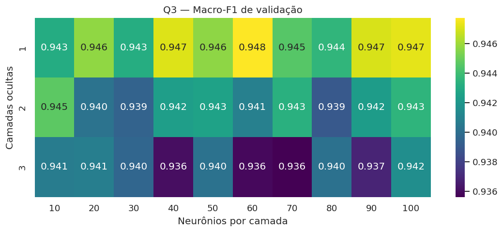

*Figura 5 — Macro-F1 de validação por topologia (Q3).*

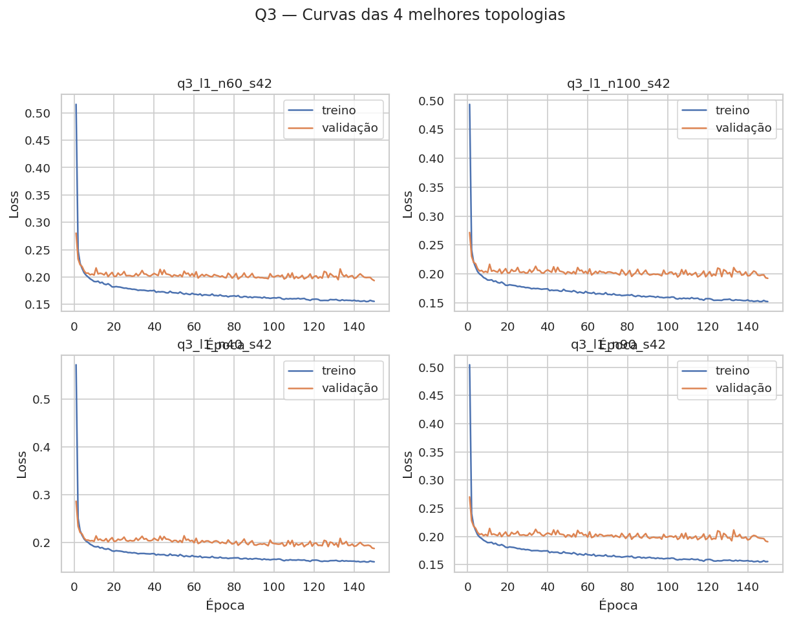

*Figura 6 — Curvas das quatro melhores topologias (Q3).*

**Análise.** Redes com uma única camada oculta tiveram o melhor desempenho médio (macro-F1 médio 0.9455); duas e três camadas apresentaram médias de 0.9418 e 0.9387, respectivamente. O aumento de profundidade também elevou o tempo médio de 133.8s para 184.4s e a loss de validação, sugerindo maior dificuldade de otimização e/ou overfitting.

As quatro melhores foram todas de uma camada oculta: 60, 100, 40 e 90 neurônios. A melhor foi 1×60 (macro-F1 0.9477); a 1×100 ficou muito próxima (0.9473) e foi posteriormente vencedora na Q6.

**Conclusão da Q3.** A complexidade adicional não trouxe ganho de generalização. As topologias 1×60, 1×100, 1×40 e 1×90 seguiram para a Q6.

## 7. Resultados e discussão — Q4

**Configuração.** Melhor configuração da Q3 (1×60), todos os 16 atributos, frações de 20–100% do treino de 56%, amostragem estratificada, scaler no subconjunto e validação fixa.

| fraction | n_train | loss_train | acc_train | loss_val | acc_val | macro_f1_val | time_s | selected |
|---|---|---|---|---|---|---|---|---|
| 0.2000 | 1524 | 0.1521 | 0.9495 | 0.2301 | 0.9307 | 0.9429 | 20.9326 | False |
| 0.4000 | 3048 | 0.1556 | 0.9406 | 0.2166 | 0.9255 | 0.9404 | 28.1193 | False |
| 0.6000 | 4572 | 0.1506 | 0.9451 | 0.2106 | 0.9297 | 0.9432 | 34.1574 | False |
| 0.8000 | 6096 | 0.1543 | 0.9447 | 0.2079 | 0.9297 | 0.9431 | 45.7460 | False |
| 1.0000 | 7621 | 0.1524 | 0.9448 | 0.1934 | 0.9334 | 0.9477 | 51.2518 | True |

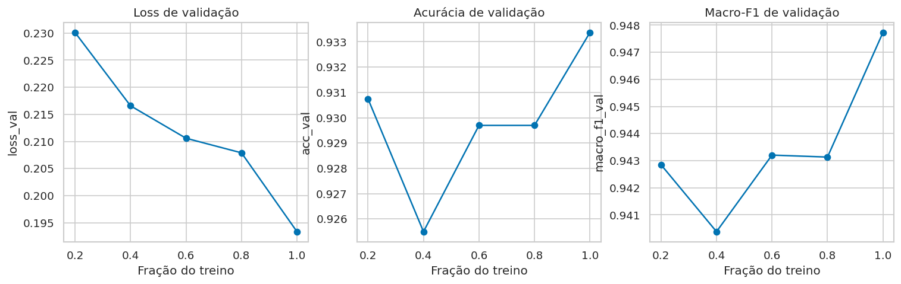

*Figura 7 — Curvas de generalização por fração de treino (Q4).*

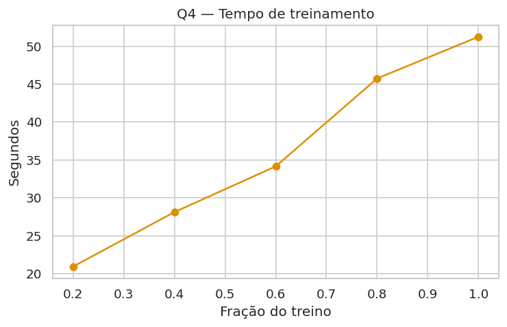

*Figura 8 — Tempo de treinamento por fração (Q4).*

**Análise.** O desempenho de validação melhorou de forma geral com o aumento dos dados: a macro-F1 foi 0.9429 com 20% e 0.9477 com 100%; a loss de validação caiu de 0.2301 para 0.1934. O tempo de treinamento cresceu de 20.9s para 51.3s. A fração de 40% apresentou um resultado ligeiramente inferior ao de 20%, indicando ruído de amostragem com uma única seed; a tendência global, porém, é de melhora com mais dados.

**Conclusão da Q4.** Mais dados melhoraram a generalização, com retorno decrescente. A fração de 100% foi selecionada e o modelo final da Q6 usou todo o desenvolvimento de 70%.

## 8. Resultados e discussão — Q5

**Configuração.** Melhor configuração da Q3 + hiperparâmetros da Q2; treino/validação de 56%/14%. A informação mútua, a variância e a correlação foram calculadas somente no treino. A regra `low_redundancy` remove, em cada componente de correlação ≥ 0,95, o atributo de menor MI.

**Atributos e relevância.**

| feature | variance | mutual_info | low_redundancy | top_10_mi | compact | no_noise |
|---|---|---|---|---|---|---|
| Perimeter | 45407.71484 | 1.06276 | True | True | True | True |
| EquivDiameter | 3459.93848 | 1.03731 | False | True | False | True |
| ConvexArea | 871674560.00000 | 1.03600 | False | True | False | True |
| Area | 845741504.00000 | 1.03600 | False | True | False | True |
| MajorAxisLength | 7272.54248 | 0.99203 | False | True | False | True |
| ShapeFactor2 | 0.00000 | 0.95457 | True | True | True | True |
| MinorAxisLength | 1996.55688 | 0.93145 | False | True | False | True |
| ShapeFactor1 | 0.00000 | 0.92642 | True | True | True | True |
| ShapeFactor3 | 0.00976 | 0.82443 | True | True | True | True |
| Compactness | 0.00380 | 0.82442 | False | True | False | True |
| AspectRatio | 0.06099 | 0.81673 | False | False | False | True |
| Eccentricity | 0.00838 | 0.81667 | False | False | False | True |
| Roundness | 0.00355 | 0.79726 | True | False | True | True |
| ShapeFactor4 | 0.00002 | 0.34984 | True | False | True | True |
| Solidity | 0.00002 | 0.24288 | True | False | True | True |
| Extent | 0.00240 | 0.20330 | True | False | True | True |

**Subconjuntos comparados.**

| subset | n_features | loss_train | acc_train | loss_val | acc_val | macro_f1_val | time_s | selected |
|---|---|---|---|---|---|---|---|---|
| low_redundancy | 8 | 0.1522 | 0.9438 | 0.1871 | 0.9307 | 0.9452 | 50.8499 | True |
| all_16 | 16 | 0.1524 | 0.9448 | 0.1934 | 0.9334 | 0.9477 | 51.3290 | False |
| no_noise | 16 | 0.1524 | 0.9448 | 0.1934 | 0.9334 | 0.9477 | 0.0000 | False |
| compact | 8 | 0.1522 | 0.9438 | 0.1871 | 0.9307 | 0.9452 | 54.8343 | False |
| top_10_mi | 10 | 0.2187 | 0.9171 | 0.2349 | 0.9098 | 0.9235 | 51.7245 | False |

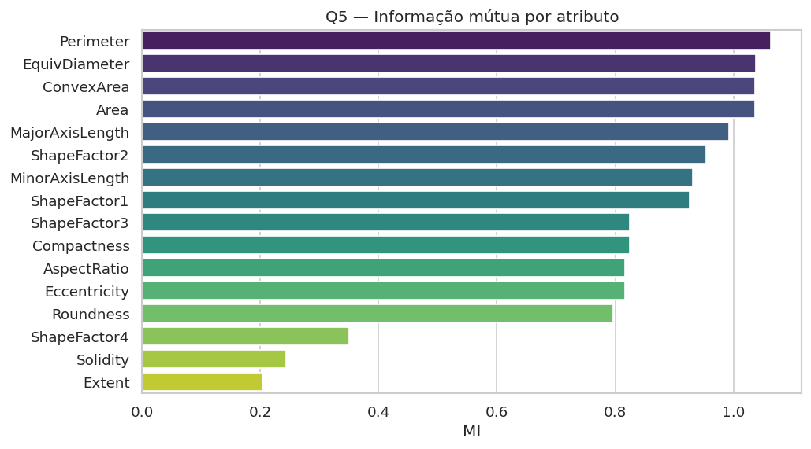

*Figura 9 — Ranking de informação mútua (Q5).*

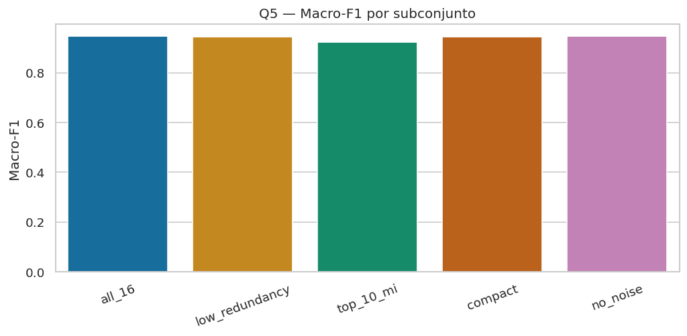

*Figura 10 — Comparação dos subconjuntos (Q5).*

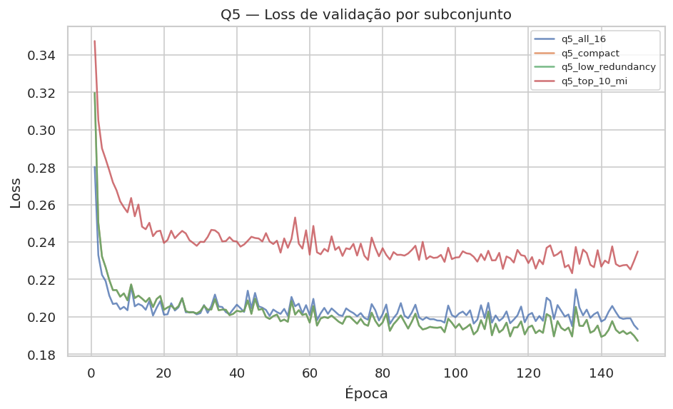

*Figura 11 — Loss de validação por subconjunto (Q5).*

**Análise.** Os atributos de maior informação mútua foram Perimeter (1.0628), EquivDiameter (1.0373), ConvexArea (1.0360) e Area (1.0360). Os menores valores ficaram com Extent (0.2033), Solidity (0.2429) e ShapeFactor4 (0.3498).

O conjunto completo obteve macro-F1 0.9477; o subconjunto `low_redundancy`, com 8 atributos (Perimeter, Extent, Solidity, Roundness, ShapeFactor1, ShapeFactor2, ShapeFactor3, ShapeFactor4), obteve 0.9452, dentro da tolerância de 0,005 e com menos atributos, sendo selecionado pela regra de parcimônia. Os atributos removidos por redundância foram: EquivDiameter, ConvexArea, Area, MajorAxisLength, MinorAxisLength, Compactness, AspectRatio, Eccentricity. O `top_10_mi` foi pior (0.9235), possivelmente por manter atributos altamente correlacionados. A regra de ruído não removeu nenhum atributo, e o subconjunto `no_noise` foi equivalente ao conjunto completo.

**Conclusão da Q5.** A remoção de redundância reduziu a dimensionalidade de 16 para 8 sem perda relevante de macro-F1. A regra `low_redundancy` foi adotada na Q6 e reajustada em cada fold da Q7.

## 9. Resultados e discussão — Q6

**Configuração.** Quatro topologias da Q3, hiperparâmetros da Q2 (lr=0,01, momento=0,9), regra `low_redundancy` reajustada no desenvolvimento de 70%, treino no desenvolvimento e avaliação no teste de 30% (4.084 exemplos), máximo de 150 épocas. As curvas de teste foram registradas por callback apenas para visualização; a parada usou exclusivamente a loss de treino.

| run_id | n_layers | neurons | n_params | loss_train | acc_train | macro_f1_train | loss_test | acc_test | macro_f1_test | weighted_f1_test | time_s | selected |
|---|---|---|---|---|---|---|---|---|---|---|---|---|
| q6_q3_l1_n100_s42 | 1 | 100 | 1607 | 0.1493 | 0.9448 | 0.9542 | 0.1963 | 0.9280 | 0.9402 | 0.9280 | 83.8198 | True |
| q6_q3_l1_n40_s42 | 1 | 40 | 647 | 0.1564 | 0.9417 | 0.9516 | 0.1955 | 0.9283 | 0.9401 | 0.9283 | 83.4484 | False |
| q6_q3_l1_n90_s42 | 1 | 90 | 1447 | 0.1491 | 0.9446 | 0.9544 | 0.1973 | 0.9275 | 0.9396 | 0.9275 | 83.6259 | False |
| q6_q3_l1_n60_s42 | 1 | 60 | 967 | 0.1516 | 0.9444 | 0.9543 | 0.1975 | 0.9270 | 0.9395 | 0.9270 | 78.9264 | False |

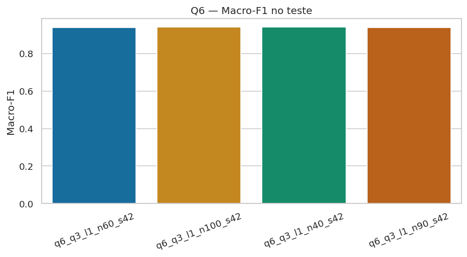

*Figura 12 — Macro-F1 no teste (Q6).*

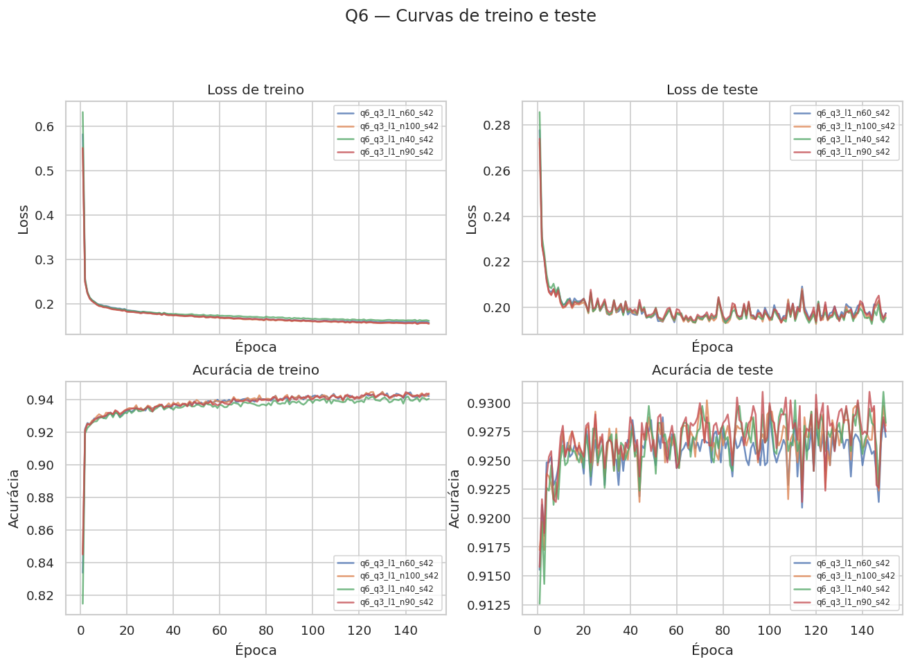

*Figura 13 — Curvas de treino e teste (Q6).*

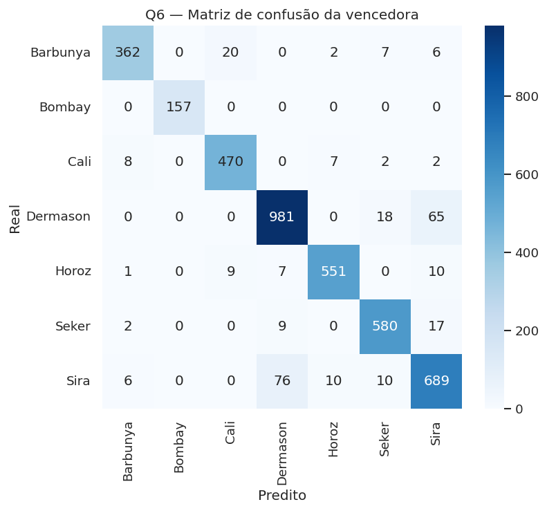

*Figura 14 — Matriz de confusão da configuração vencedora (Q6).*

**Análise.** A configuração vencedora foi **1×100**, com macro-F1 de teste 0.9402, weighted-F1 0.9280, acurácia 0.9280 e loss de teste 0.1963. As quatro configurações ficaram muito próximas: a diferença de macro-F1 entre a primeira e a última foi de apenas 0.0008. A 1×40 teve a menor loss de teste (0.1955) e a maior precisão macro (0.9418), mas macro-F1 ligeiramente inferior.

A loss de teste (0.1963) foi superior à de treino (0.1493), e o macro-F1 caiu de 0.9542 no treino para 0.9402 no teste, indicando generalização imperfeita e possível overfitting. A Tabela de classificação por classe mostra que Bombay foi perfeitamente separada (F1 1,000), enquanto Sira (F1 0.8722) e Dermason (F1 0.9181) foram as mais difíceis.

**Classificação por classe da vencedora.**

| class | precision | recall | f1-score | support |
|---|---|---|---|---|
| Barbunya | 0.9551 | 0.9118 | 0.9330 | 397.0000 |
| Bombay | 1.0000 | 1.0000 | 1.0000 | 157.0000 |
| Cali | 0.9419 | 0.9611 | 0.9514 | 489.0000 |
| Dermason | 0.9143 | 0.9220 | 0.9181 | 1064.0000 |
| Horoz | 0.9667 | 0.9533 | 0.9599 | 578.0000 |
| Seker | 0.9400 | 0.9539 | 0.9469 | 608.0000 |
| Sira | 0.8733 | 0.8710 | 0.8722 | 791.0000 |

**Conclusão da Q6.** A 1×100 foi selecionada como configuração final. As diferenças entre as topologias são pequenas; a escolha se baseia no macro-F1 de teste, conforme o critério definido.

## 10. Resultados e discussão — Q7

**Configuração.** Validação cruzada k=5 estratificada no desenvolvimento de 70% (9.528 exemplos), com a configuração 1×100, lr=0,01, momento=0,9 e regra `low_redundancy` reajustada em cada fold. O teste de 30% não foi usado.

| fold | loss_train | acc_train | loss_val | acc_val | macro_f1_val | weighted_f1_val | time_s |
|---|---|---|---|---|---|---|---|
| 0.0000 | 0.1521 | 0.9452 | 0.1959 | 0.9334 | 0.9437 | 0.9334 | 55.5266 |
| 1.0000 | 0.1527 | 0.9408 | 0.1910 | 0.9307 | 0.9418 | 0.9311 | 56.6814 |
| 2.0000 | 0.1550 | 0.9421 | 0.1828 | 0.9270 | 0.9406 | 0.9275 | 53.5523 |
| 3.0000 | 0.1469 | 0.9459 | 0.1910 | 0.9354 | 0.9482 | 0.9357 | 52.2615 |
| 4.0000 | 0.1496 | 0.9428 | 0.1804 | 0.9417 | 0.9525 | 0.9417 | 54.2360 |

**Resumo entre folds.**

| metric | mean | variance | std | min | max |
|---|---|---|---|---|---|
| loss_train | 0.151258 | 0.000010 | 0.003083 | 0.146948 | 0.154964 |
| acc_train | 0.943371 | 0.000005 | 0.002130 | 0.940821 | 0.945946 |
| loss_val | 0.188222 | 0.000041 | 0.006425 | 0.180397 | 0.195908 |
| acc_val | 0.933663 | 0.000030 | 0.005495 | 0.927034 | 0.941732 |
| macro_f1_val | 0.945351 | 0.000024 | 0.004933 | 0.940589 | 0.952475 |
| weighted_f1_val | 0.933872 | 0.000028 | 0.005326 | 0.927511 | 0.941709 |
| precision_macro_val | 0.946660 | 0.000018 | 0.004197 | 0.941825 | 0.952363 |
| recall_macro_val | 0.944574 | 0.000030 | 0.005515 | 0.940259 | 0.952850 |
| epochs | 150.000000 | 0.000000 | 0.000000 | 150.000000 | 150.000000 |
| time_s | 54.451551 | 2.944813 | 1.716046 | 52.261496 | 56.681360 |

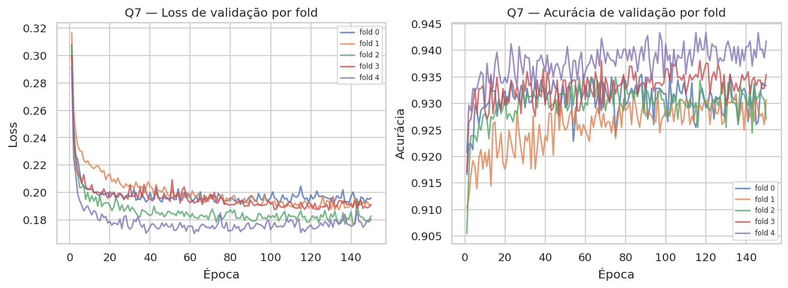

*Figura 15 — Curvas de validação por fold (Q7).*

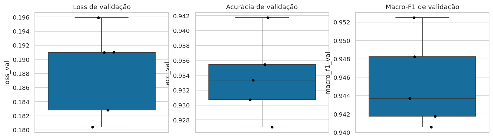

*Figura 16 — Distribuição das métricas entre folds (Q7).*

**Análise.** A macro-F1 de validação teve média 0.9454, variância 0.000024 e desvio-padrão 0.0049. A acurácia média foi 0.9337 (variância 0.000030) e a loss média 0.1882 (variância 0.000041). Os folds 0–4 apresentaram macro-F1 de 0.9437, 0.9418, 0.9406, 0.9482, 0.9525.

A variabilidade é pequena, indicando robustez razoável à partição. O fold 2 foi o mais fraco e o fold 4 o melhor; a regra de atributos selecionou 8 features com pequenas variações entre folds, refletindo a estrutura de correlação dos dados. A média da CV (0.9454) ficou acima do resultado da Q6 no teste (0.9402); isso é esperado porque a CV usa o desenvolvimento de 70% e avalia partições de 20%, enquanto a Q6 avalia um holdout de 30% após seleção.

**Limitação.** A Q6 selecionou a configuração no teste; portanto, a Q7 é uma análise de robustez pós-seleção, não um segundo holdout independente.

**Conclusão da Q7.** O modelo final é consistente entre partições, com desvio-padrão de aproximadamente 0.005 em macro-F1. A variância baixa sustenta a escolha da configuração 1×100.

## 11. Conclusão geral

O estudo cumpriu as sete etapas. A Q1 mostrou que a MLP 16-60-7 aprende de forma estável, com baixa sensibilidade à inicialização. A Q2 indicou lr=0,01 e momento=0,9 como a melhor combinação, com macro-F1 de validação 0.9477. A Q3 mostrou que uma única camada oculta é suficiente: as quatro melhores topologias foram 1×60, 1×100, 1×40 e 1×90; redes mais profundas aumentaram tempo e loss de validação. A Q4 evidenciou ganho com mais dados até 100%, com retorno decrescente. A Q5 mostrou que a remoção de redundância reduziu 16 atributos para 8 sem perda relevante de macro-F1. A Q6 selecionou a configuração **1×100** com macro-F1 de teste 0.9402. A Q7 confirmou a robustez, com macro-F1 média 0.9454, variância 0.000024 e desvio-padrão 0.0049.

**Configuração final recomendada:** uma camada oculta com 100 neurônios, ReLU, Softmax, SGD com lr=0,01 e momento=0,9, batch 32, 8 atributos selecionados pela regra `low_redundancy` e entropia cruzada categórica.

**Limitações.** (i) No protocolo principal de 150 épocas, nenhuma configuração atingiu a loss de treino de 0,001; o critério foi registrado, mas não satisfeito. O piloto suplementar Q2b (Apêndice B) mostrou que o alvo é atingível com 3×256 e 408 épocas, porém com overfitting e desempenho de teste inferior ao da V1. (ii) Q2–Q6 usaram uma única seed; a estabilidade foi avaliada na Q1 e na Q7. (iii) A Q6 selecionou a vencedora no teste, e a Q7 é uma análise de robustez pós-seleção. (iv) Não foram usados regularização, dropout ou class weights; o desbalanceamento foi tratado apenas via macro-F1 e splits estratificados. (v) Os limiares de correlação (0,95) e de ruído (percentil 10 + mediana) são decisões metodológicas.

**Trabalhos futuros.** Buscar um equilíbrio entre convergência de treino e generalização, por exemplo com regularização, early stopping na validação e class weights; repetir Q2–Q6 com múltiplas seeds; e usar validação cruzada aninhada para seleção e avaliação totalmente independentes.

## Referências

- UCI Machine Learning Repository. **Dry Bean Dataset**, ID 602. Disponível em: https://archive.ics.uci.edu/dataset/602/dry+bean+dataset.
- KOKLU, M.; OZKAN, I. A. Multiclass Classification of Dry Beans Using Computer Vision and Machine Learning Techniques. *Computers and Electronics in Agriculture*, v. 174, 2020.
- TensorFlow/Keras e Scikit-learn: documentação oficial das versões utilizadas.

## Apêndice A — consolidado dos vencedores

| stage | configuration | selection_metric | value |
|---|---|---|---|
| Q2 | lr=0.01; momentum=0.9 | macro_f1_val | 0.9477 |
| Q3_top1 | layers=1; neurons=60 | macro_f1_val | 0.9477 |
| Q3_top2 | layers=1; neurons=100 | macro_f1_val | 0.9473 |
| Q3_top3 | layers=1; neurons=40 | macro_f1_val | 0.9471 |
| Q3_top4 | layers=1; neurons=90 | macro_f1_val | 0.9470 |
| Q4 | fraction=1.0 | macro_f1_val | 0.9477 |
| Q5 | subset=low_redundancy; n_features=8 | macro_f1_val | 0.9452 |
| Q6 | layers=1; neurons=100; lr=0.01; momentum=0.9; features=8 | macro_f1_test | 0.9402 |
| Q7 | k=5; desenvolvimento 70% | macro_f1_val_mean | 0.9454 |

## Apêndice B — Piloto de convergência Q2b

Este experimento foi realizado na branch `feat/q2b-convergencia-500ep`, após o congelamento da V1.0.0. Ele não altera as sete questões originais nem o modelo oficial da V1.

**Objetivo.** Testar se uma rede maior, com até 500 épocas e scheduler, atinge a loss de treino ≤ 0,001. O teste foi usado apenas na avaliação final.

**Configuração.**

| Item | Valor |
|---|---|
| Topologia | 3 camadas × 256 neurônios |
| Ativações | ReLU / Softmax |
| Perda | Entropia cruzada categórica |
| Otimizador | SGD, momentum 0,9 |
| Learning rate | 0,01 com `ReduceLROnPlateau` (fator 0,5, paciência 20, mínimo 1e-5) |
| Batch | 32 |
| Dados de treino | 70% de desenvolvimento |
| Teste | 30%, apenas na avaliação final |
| Máximo de épocas | 500 |
| Seed | 42 |
| Parâmetros | 137.735 |

**Resultado.**

| Métrica | Valor |
|---|---|
| Status | Convergiu |
| Motivo da parada | `target` |
| Épocas executadas | 408 |
| Melhor loss de treino | 0,000967 (época 408) |
| Loss de treino (avaliação) | 0,000943 |
| Acurácia de treino | 1,0000 |
| Macro-F1 de treino | 1,0000 |
| Loss de teste | 0,7864 |
| Acurácia de teste | 0,9185 |
| Macro-F1 de teste | 0,9323 |
| Weighted-F1 de teste | 0,9185 |
| Tempo de treino | 277,8 s |

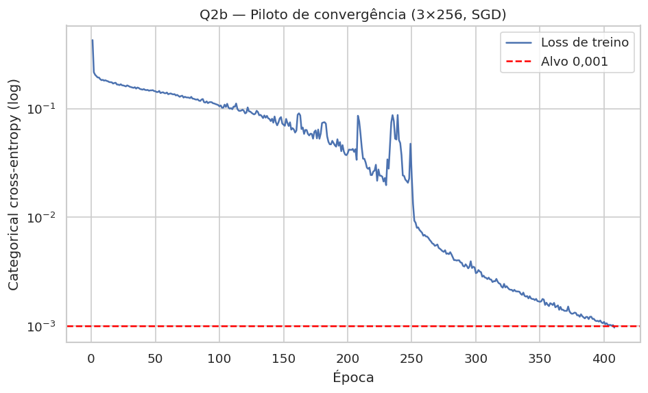

*Figura 17 — Loss de treino do piloto Q2b (escala logarítmica) e alvo de 0,001.*

**Análise.** O piloto atingiu o critério de 0,001 na época 408, confirmando que o alvo é viável com uma rede maior e scheduler. O custo foi overfitting acentuado: acurácia e macro-F1 de treino chegaram a 1,0000, enquanto no teste a acurácia foi 0,9185 e o macro-F1 0,9323; a loss de teste subiu para 0,7864. O desempenho de teste ficou abaixo do modelo da V1 (macro-F1 0,9402).

**Conclusão.** O critério é alcançável, mas não é gratuito: a busca por loss de treino muito baixa sacrificou generalização. Por isso, a V1 permanece como entrega oficial e o Q2b é registrado como evidência suplementar. O relatório detalhado do piloto está em `experiments/q2b_500ep.md`.
